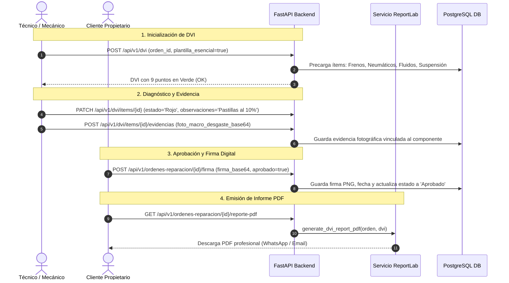

# 🏍️ Sistema de Gestión de Taller Automotriz y Motos (PMV)

Backend profesional y escalable para la gestión integral de órdenes de reparación, clientes, vehículos, bahías de trabajo, streaming de video en vivo de cámaras, **Inspección Digital de Vehículo (DVI Esencial)**, **Firma Digitalizada de Clientes** y **Generación de Informes Técnicos en PDF** para talleres automotrices y de motocicletas.

Diseñado bajo principios de **Clean Architecture**, alta cohesión y bajo acoplamiento.

---

## 🛠️ Stack Tecnológico

- **Lenguaje**: Python 3.11+ (Probado en Python 3.13)
- **Framework Web**: [FastAPI](https://fastapi.tiangolo.com/) (Alto rendimiento, OpenAPI nativo y tipado estático)
- **ORM**: [SQLAlchemy 2.0](https://docs.sqlalchemy.org/) (Sintaxis moderna con `Mapped` y `mapped_column`)
- **Validación y DTOs**: [Pydantic v2](https://docs.pydantic.dev/) + `pydantic-settings`
- **Gestión de Migraciones**: [Alembic](https://alembic.sqlalchemy.org/)
- **Generación de Documentos PDF**: [ReportLab](https://www.reportlab.com/) + Pillow
- **Streaming Gateway**: [MediaMTX](https://github.com/bluenviron/mediamtx) / [go2rtc](https://github.com/AlexxIT/go2rtc) (Conversión RTSP a WebRTC WHEP / HLS)
- **Componente Frontend**: React + TypeScript + HTML5 Canvas (`LiveBayCameraPlayer.tsx`)
- **Pruebas Automatizadas**: [Pytest](https://docs.pytest.org/) + `httpx` (con SQLite en memoria aislado)
- **Motor de Base de Datos**: PostgreSQL
- **Servidor ASGI**: Uvicorn

---

## 📐 Modelo de Datos y Relaciones (ERD)

```mermaid
erDiagram
    CLIENTES ||--o{ VEHICULOS : "posee (1:N)"
    VEHICULOS ||--o{ ORDENES_REPARACION : "tiene (1:N)"
    BAHIAS ||--o{ CAMARAS : "alberga (1:N)"
    BAHIAS ||--o{ ORDENES_REPARACION : "atiende (1:N)"
    ORDENES_REPARACION ||--o{ EVIDENCIAS_INSPECCION : "adjunta (1:N)"
    ORDENES_REPARACION ||--o| INSPECCIONES_DVI : "diagnostica (1:1)"
    INSPECCIONES_DVI ||--o{ ITEMS_DVI : "evalua (1:N)"
    ITEMS_DVI ||--o{ EVIDENCIAS_ITEM_DVI : "respalda (1:N)"

    CLIENTES {
        int id PK
        varchar nombre
        varchar telefono
        varchar email
        tipo_cliente_enum tipo
    }

    VEHICULOS {
        int id PK
        int cliente_id FK
        varchar marca
        varchar modelo
        varchar placa UK
        int kilometraje_actual
        nivel_combustible_enum nivel_combustible
    }

    ORDENES_REPARACION {
        int id PK
        int vehiculo_id FK
        int bahia_id FK
        estado_orden_enum estado
        text notas_recepcion
    }

    INSPECCIONES_DVI {
        int id PK
        int orden_id FK_UK
        varchar tecnico_responsable
        text notas_generales
        varchar firma_cliente
        varchar nombre_firmante
        timestamptz fecha_firma
        estado_aprobacion_enum estado_aprobacion
    }

    ITEMS_DVI {
        int id PK
        int inspeccion_id FK
        varchar categoria
        varchar nombre_item
        estado_dvi_enum estado "Verde | Amarillo | Rojo"
        text observaciones
    }

    EVIDENCIAS_ITEM_DVI {
        int id PK
        int item_dvi_id FK
        tipo_evidencia_dvi_enum tipo_archivo "foto | video"
        varchar archivo_path
        varchar descripcion
    }
```

---

## 🚦 Flujo de la Inspección Digital (DVI) y Firma del Cliente



---

## 📁 Estructura del Proyecto

```text
Proyecto_moto/
├── alembic/                          # Sistema de migraciones
│   ├── versions/
│   │   ├── 0001_initial_schema.py   # Clientes, Vehículos, OR
│   │   ├── 0002_add_bahias_and_camaras.py # Bahías, Cámaras, Evidencias
│   │   └── 0003_add_dvi_and_firmas.py     # DVI, Items, Firma Digital
│   ├── env.py
│   └── script.py.mako
├── app/
│   ├── api/                          # Endpoints REST
│   │   └── v1/
│   │       ├── endpoints/
│   │       │   ├── clientes.py       # CRUD y Búsqueda de Clientes
│   │       │   ├── vehiculos.py      # Asociación de vehículos, odómetro y combustible
│   │       │   ├── ordenes.py        # Recepción, seguimiento OR, firma y PDF
│   │       │   ├── bahias.py         # Bahías y fotos de cámara
│   │       │   ├── camaras.py        # Cámaras IP y streaming
│   │       │   └── dvi.py            # DVI, checklist semáforo, evidencias y firma
│   │       └── router.py             # Router centralizado
│   ├── core/
│   │   ├── config.py                 # Pydantic Settings (.env)
│   │   └── database.py               # Engine, SessionLocal y Base Declarativa
│   ├── models/                       # Modelos ORM (SQLAlchemy 2.0)
│   │   ├── cliente.py
│   │   ├── vehiculo.py
│   │   ├── orden_reparacion.py
│   │   ├── bahia.py
│   │   ├── camara.py
│   │   ├── evidencia.py
│   │   └── dvi.py                    # InspeccionDVI, ItemDVI, EvidenciaItemDVI
│   ├── schemas/                      # DTOs Pydantic v2
│   │   ├── cliente.py
│   │   ├── vehiculo.py
│   │   ├── orden_reparacion.py
│   │   ├── bahia.py
│   │   ├── camara.py
│   │   ├── evidencia.py
│   │   └── dvi.py
│   ├── services/                     # Servicios del Dominio
│   │   └── pdf_generator.py          # Compilador ReportLab de DVI + Fotos + Firma
│   └── main.py                       # FastAPI App y CORS
├── frontend-components/              # Componente de Integración
│   ├── LiveBayCameraPlayer.tsx       # React + WebRTC WHEP + Captura Canvas
│   ├── docker-compose.mediamtx.yml   # Gateway MediaMTX
│   └── README.md
├── tests/                            # Suite Pytest
│   ├── conftest.py                   # Fixture SQLite en memoria aislado
│   ├── test_recepcion_flow.py        # Tests del flujo de recepción
│   ├── test_camaras_flow.py          # Tests de bahías y streaming
│   └── test_dvi_and_pdf_flow.py      # Tests de DVI, firma y PDF
├── .env.example
├── requirements.txt
└── README.md
```

---

## 🚀 Guía de Instalación y Pruebas

### 1. Activar entorno virtual e instalar dependencias
```bash
# Windows PowerShell
.\.venv\Scripts\Activate.ps1
pip install -r requirements.txt
```

### 2. Ejecutar la suite completa de pruebas unitarias (Pytest)
```bash
pytest -v
```

Resultado verificado:
```text
tests/test_camaras_flow.py::test_registro_bahias_y_camaras PASSED        [ 12%]
tests/test_camaras_flow.py::test_captura_foto_inspeccion_en_bahia PASSED [ 25%]
tests/test_dvi_and_pdf_flow.py::test_flujo_completo_dvi_firma_y_pdf PASSED [ 37%]
tests/test_dvi_and_pdf_flow.py::test_dvi_orden_inexistente PASSED        [ 50%]
tests/test_recepcion_flow.py::test_crear_y_buscar_cliente PASSED         [ 62%]
tests/test_recepcion_flow.py::test_asociar_vehiculo_a_cliente PASSED     [ 75%]
tests/test_recepcion_flow.py::test_creacion_completa_orden_reparacion_desde_cero PASSED [ 87%]
tests/test_recepcion_flow.py::test_validaciones_orden_reparacion PASSED  [100%]
======================== 8 passed in 33.27s ========================
```

### 3. Migraciones con Alembic (PostgreSQL)
```bash
alembic upgrade head
```

### 4. Iniciar el servidor FastAPI
```bash
uvicorn app.main:app --reload --port 8000
```

---

## 📡 Endpoints del Módulo DVI y Documentos

| Método | Endpoint | Resumen |
| :--- | :--- | :--- |
| `POST` | `/api/v1/dvi` | Inicializar DVI (con plantilla esencial o ítems a medida) |
| `GET` | `/api/v1/dvi/orden/{orden_id}` | Obtener DVI con checklist, semáforo y evidencias |
| `PATCH` | `/api/v1/dvi/items/{item_id}` | Actualizar estado semáforo (`Verde`, `Amarillo`, `Rojo`) y observaciones |
| `POST` | `/api/v1/dvi/items/{item_id}/evidencias` | Adjuntar foto o clip de video corto a un ítem |
| `POST` | `/api/v1/ordenes-reparacion/{id}/firma` | **Firma Digital**: Guarda firma PNG, fecha y aprobación del cliente |
| `GET` | `/api/v1/ordenes-reparacion/{id}/reporte-pdf` | **Descarga de PDF**: Genera informe compilado listo para WhatsApp |
