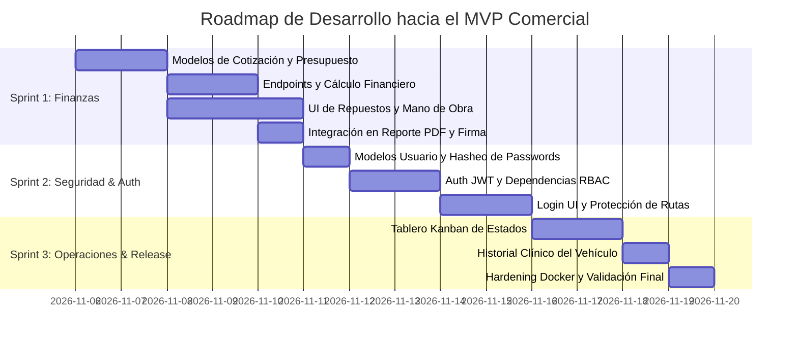

# Plan Maestro de Desarrollo: Hoja de Ruta hacia el MVP 1.0

Este documento desglosa el plan de ejecución técnico y operativo para cerrar las brechas identificadas en la evaluación de madurez y convertir el software de taller de motos/autos en un **MVP comercialmente viable y listo para producción**.

---

## 1. Visión General del Roadmap (3 Sprints de Ejecución)

---

## 2. Desglose Detallado por Sprints

### 🟢 Sprint 1: Módulo Financiero (Presupuestos, Repuestos y Cobro)
**Objetivo:** Permitir al taller cotizar reparaciones, agregar piezas/repuestos y mano de obra, totalizar con impuestos y reflejar los montos en el reporte PDF y en la firma de aprobación.

#### 1. Backend (FastAPI / SQLAlchemy)
* **Modelos relacionales a crear (`app/models/presupuesto.py`):**
  * `Presupuesto`:
    * `id`: PK
    * `orden_id`: FK -> `ordenes_reparacion.id` (1 a 1 o 1 a N)
    * `estado`: Enum (`Borrador`, `Aprobado`, `Rechazado`)
    * `subtotal`, `impuesto_porcentaje` (ej. 16% / IVA), `descuento`, `total`
    * `moneda`: String (default `"MXN"`)
  * `ItemPresupuesto`:
    * `id`: PK
    * `presupuesto_id`: FK -> `presupuestos.id`
    * `tipo`: Enum (`Repuesto`, `Mano de Obra`, `Servicio Externo`)
    * `descripcion`: String (ej. "Pastillas de freno cerámicas", "Bajada de motor")
    * `cantidad`: Decimal o Float (default 1.0)
    * `precio_unitario`: Decimal o Float
    * `subtotal`: Columna calculada o persistida (`cantidad * precio_unitario`)
  * `Pago`:
    * `id`: PK
    * `orden_id`: FK -> `ordenes_reparacion.id`
    * `monto`: Decimal
    * `metodo_pago`: Enum (`Efectivo`, `Transferencia`, `Tarjeta_Debito`, `Tarjeta_Credito`)
    * `referencia`: String opcional (número de voucher/transacción)
    * `fecha_pago`: DateTime

* **Endpoints a implementar (`app/api/v1/endpoints/presupuestos.py`):**
  * `POST /ordenes-reparacion/{id}/presupuesto`: Crear o actualizar presupuesto.
  * `POST /presupuestos/{id}/items`: Agregar un ítem de repuesto o servicio.
  * `DELETE /presupuestos/items/{item_id}`: Eliminar ítem.
  * `POST /ordenes-reparacion/{id}/pagos`: Registrar abono o pago total.
  * `GET /ordenes-reparacion/{id}/balance`: Obtener total orden, total pagado y saldo pendiente.

* **Actualización del Servicio PDF (`app/services/pdf_generator.py`):**
  * Insertar tabla desglosada de repuestos y mano de obra en el reporte de ReportLab.
  * Mostrar resumen financiero claro: *Subtotal*, *IVA (16%)*, *Total a Pagar* y *Saldo Pendiente*.

#### 2. Frontend (React / Tailwind)
* **Componente `PresupuestoEditor.tsx`:**
  * Tabla editable para agregar rápidamente ítems (descripción, tipo, cantidad, precio).
  * Selector de ítems vinculados a los hallazgos del DVI (ej. si el DVI marcó "Pastillas en Rojo", sugerir "Pastillas de freno" con un clic).
  * Resumen dinámico en vivo (Subtotal, IVA, Total).
* **Modal de Registro de Pagos:**
  * Botón "Cobrar / Registrar Pago" con selector de método de pago y comprobante.

---

### 🟡 Sprint 2: Autenticación, Usuarios y Control de Acceso (RBAC)
**Objetivo:** Proteger el sistema para que solo personal autorizado pueda operar según sus funciones.

#### 1. Backend (FastAPI / SQLAlchemy)
* **Dependencias a instalar:** `python-jose[cryptography]`, `passlib[bcrypt]` o `pwdlib`.
* **Modelo `Usuario` (`app/models/usuario.py`):**
  * `id`: PK
  * `email`: String único
  * `nombre_completo`: String
  * `hashed_password`: String
  * `rol`: Enum (`administrador`, `recepcionista`, `mecanico`)
  * `is_active`: Boolean (default True)
  * `bahia_id`: FK opcional -> `bahias.id` (para asociar mecánicos fijos a una bahía)
* **Endpoints de Seguridad (`app/api/v1/endpoints/auth.py`):**
  * `POST /auth/login`: Autenticación por `username` (email) y `password` -> retorna `access_token` JWT.
  * `GET /auth/me`: Retorna los datos del usuario logueado y su rol.
* **Seguridad en Endpoints Existentes:**
  * Inyectar dependencia `Depends(get_current_active_user)`.
  * Restringir acciones destructivas (ej. eliminar órdenes, modificar precios finales) a rol `administrador`.

#### 2. Frontend (React / Tailwind)
* **Vistas y Contextos:**
  * `LoginPage.tsx`: Formulario de inicio de sesión limpio y responsivo con credenciales guardadas en `localStorage` o `sessionStorage`.
  * `AuthContext.tsx`: Contexto global que mantiene el estado del usuario logueado, token y rol.
  * Interceptor de Axios en `src/api/client.ts` para enviar cabecera `Authorization: Bearer <token>` y redirigir al login en caso de error 401.
  * Renderizado condicional en el menú lateral: los mecánicos solo ven sus bahías y DVI; recepción ve clientes y cobros; el dueño ve todo.

---

### 🔵 Sprint 3: Flujo Operativo (Kanban, Historial y Release)
**Objetivo:** Optimizar la experiencia diaria en el piso del taller y consolidar el despliegue.

#### 1. Tablero Kanban de Órdenes (`KanbanBoard.tsx`)
* Columnas basadas en los estados del taller:
  1. `En Espera` (Recién ingresado)
  2. `En Diagnóstico` (Mecánico revisando con DVI)
  3. `En Reparación` (Trabajando en la moto)
  4. `Listo` (Terminado y probado)
  5. `Entregado` (Cobrado y retirado)
* Acciones rápidas en cada tarjeta:
  * Botón para avanzar de estado con un clic.
  * Badge del mecánico asignado y tiempo transcurrido en el taller.

#### 2. Historial Clínico del Vehículo
* Al escribir una placa en Recepción, consultar `GET /vehiculos/{placa}/historial`.
* Mostrar visitas previas, fallas anteriores y kilometrajes históricos para evitar fraudes de odómetro y dar confianza al cliente.

#### 3. Despliegue e Infraestructura de Producción
* Inicializar PostgreSQL y MediaMTX en el contenedor `docker-compose.yml`.
* Configuración de volumen de Docker persistente para `/uploads` y para `/var/lib/postgresql/data`.
* Script de inicialización de primer usuario Administrador (`seed_admin.py`).

---

## 3. Matriz de Entregables y Criterios de Aceptación del MVP

| Módulo | Entregable Concreto | Criterio de Aceptación (Definición de Terminado) |
|---|---|---|
| **Presupuestos** | `PresupuestoEditor.tsx` + endpoints backend | Se pueden agregar 3 repuestos y mano de obra a una orden, totaliza con IVA y se muestra en el PDF descargable. |
| **Pagos** | Modal de pagos + tabla de balances | Se puede registrar un pago parcial o total en efectivo/tarjeta y el saldo pendiente se recalcula automáticamente. |
| **Seguridad** | `POST /auth/login` + `AuthContext` | No es posible consultar órdenes sin token JWT. El mecánico no puede ver métricas financieras ni eliminar datos. |
| **Kanban** | `KanbanBoard.tsx` | El operador puede cambiar el estado de una orden a "Listo" y se refleja inmediatamente en el Dashboard. |
| **Docker** | `docker-compose up -d` | PostgreSQL almacena los datos de forma persistente entre reinicios del contenedor. |

---

## 4. Próxima Acción Inmediata

Para dar inicio al **Sprint 1 (Finanzas y Presupuesto)**, el primer paso técnico consiste en:
1. Crear el modelo relacional `Presupuesto` e `ItemPresupuesto` en SQLAlchemy.
2. Definir los esquemas Pydantic correspondientes.
3. Exponer los endpoints CRUD para cotizaciones de la Orden de Reparación.

