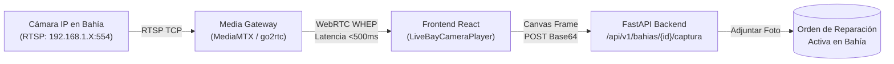

# 📹 Componente de Streaming de Cámaras y Captura de Inspección

Este módulo contiene el componente de frontend para visualizar en tiempo real las cámaras IP de cada bahía de trabajo y capturar fotografías de inspección técnica directamente desde el stream de video.

---

## 🏗️ Arquitectura de Streaming (RTSP a WebRTC)

Los navegadores web **no pueden reproducir flujos RTSP directamente**. Por tanto, la arquitectura utiliza un Media Gateway de alto rendimiento ([MediaMTX](https://github.com/bluenviron/mediamtx) o [go2rtc](https://github.com/AlexxIT/go2rtc)):



---

## 📦 Uso del Componente en React / Next.js

```tsx
import React from "react";
import { LiveBayCameraPlayer } from "./frontend-components/LiveBayCameraPlayer";

export default function BahiaMonitorView() {
  return (
    <div className="p-6 bg-gray-900 min-h-screen">
      <h1 className="text-xl font-bold text-white mb-4">Monitoreo de Bahías de Servicio</h1>
      
      <LiveBayCameraPlayer
        bahiaId={1}
        bahiaNombre="Bahía 1 - Elevador Principal"
        camaraId={1}
        streamName="bahia_1_cam_1"
        mediaGatewayHost="http://localhost:8889"
        apiBaseUrl="http://localhost:8000/api/v1"
        ordenActiva={{
          id: 101,
          estado: "En Reparación",
          vehiculoPlaca: "MOT-789",
          vehiculoModelo: "Yamaha MT-07",
        }}
        onCapturaExitosa={(evidenciaId, archivoPath) => {
          console.log(`Foto guardada con éxito (ID: ${evidenciaId}) en: ${archivoPath}`);
        }}
      />
    </div>
  );
}
```

---

## ⚡ Cómo iniciar el Media Gateway con Docker

Para habilitar la conversión RTSP a WebRTC/HLS localmente:

```bash
docker compose -f frontend-components/docker-compose.mediamtx.yml up -d
```

